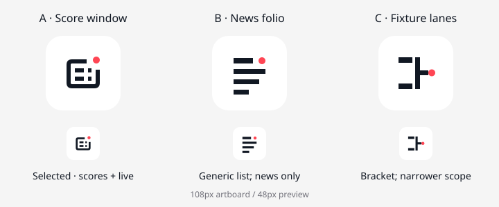

# Android 앱 아이콘

`app-icon.svg`는 두 경기 행과 LIVE 신호를 표현한 독자적인 **스코어 윈도** 원본이다. VLR.GG·Riot Games 로고, VALORANT V 마크, 게임 에셋을 사용하지 않는다. 런처 이름은 `VLR.GG Mobile`이며 Play 제목과 About의 전체 이름은 `VLR.GG Mobile (Unofficial)`이다.

## 시안 비교와 선택



| 시안 | 판단 |
| --- | --- |
| A. 스코어 윈도 | **선택.** 두 경기 행·점수 칸과 분리된 LIVE 점이 48px에서도 구별된다. 단색으로 바꿔도 창과 신호의 형태가 남는다. |
| B. 기사 묶음 | 가독성은 좋지만 일반 목록 아이콘과 비슷하고 앱의 경기 정보가 드러나지 않는다. |
| C. 대진 연결선 | 단순하지만 브래킷에 의미가 치우치며 뉴스·스코어를 함께 다루는 앱을 대표하기 어렵다. |

[현재 DESIGN.md](../../../DESIGN.md)의 `Surface #FFFFFF`, `TextBrand #111823`, `AccentLive #FF4654`를 사용한다. 빨강은 작은 신호 점에만 쓴다. [v2.1 제안](../v2.1-design-system.md)의 차분한 정보 서비스 방향도 검토했으며, 아직 미채택인 색상 토큰은 적용하지 않았다.

## 에셋과 크기

- `app-icon.svg`: 108×108 원본. 배경과 두 foreground path를 분리했다.
- `play-icon-512.png`: 512×512, RGBA 32-bit PNG, 1MB 미만. Play가 마스크를 적용하므로 사전 라운딩·그림자를 넣지 않았다.
- `drawable/ic_launcher_{background,foreground,monochrome}.xml`: 108dp VectorDrawable. monochrome은 배경 없이 같은 두 패스를 단색으로 사용한다.
- `mipmap-anydpi-v26/ic_launcher{,_round}.xml`: foreground/background와 Android 13 이상용 monochrome 레이어.
- `mipmap-{mdpi,hdpi,xhdpi,xxhdpi,xxxhdpi}`: 각 48/72/96/144/192px 일반·원형 PNG. 원본의 중앙 72dp 영역을 내보내 adaptive icon과 크기를 맞췄다.
- `drawable/ic_splash.xml`: 같은 foreground를 240dp 크기, 108단위 viewport로 사용한다. `Theme.SplashScreen.IconBackground`와 흰색 아이콘 배경으로 240dp/160dp 규격을 적용한다. 화면 배경도 DESIGN.md의 `Surface`다.

핵심 형상은 중심 `(54,54)`, 반지름 33인 66dp safe zone 안에 있다. 창의 경계는 `(30,34)`–`(78,76)`으로 가장 먼 경계 상자 모서리도 반지름 32.56 이내이며, 신호 점은 중심 `(73,35)`, 반지름 5로 중심에서 최대 31.88이다. 스플래시에서도 최대 반지름은 `32.56 × 240 / 108 = 72.36dp`로 160dp 원 안에 들어간다.

## 다시 생성하기

macOS의 Swift/AppKit SVG 렌더러를 사용한다. 앱 dependency 추가는 없다.

```sh
swift docs/design/app-icon/export.swift
./gradlew :app:androidApp:assembleDebug :app:androidApp:lintDebug
```

`app-icon.svg`를 수정한 뒤 생성기를 실행하면 네 VectorDrawable, 열 개 런처 PNG와 Play PNG가 갱신된다. 시안 비교 파일은 검토 기록이며 생성 입력이 아니다. 에뮬레이터 화면 캡처는 저장소에 포함하지 않는다. iOS 아이콘은 이 변경 범위 밖이다.

규격 근거: [Adaptive icons](https://developer.android.com/develop/ui/views/launch/icon_design_adaptive), [Splash screen dimensions](https://developer.android.com/develop/ui/views/launch/splash-screen#splash_screen_dimensions), [Google Play icon specifications](https://developer.android.com/distribute/google-play/resources/icon-design-specifications).
